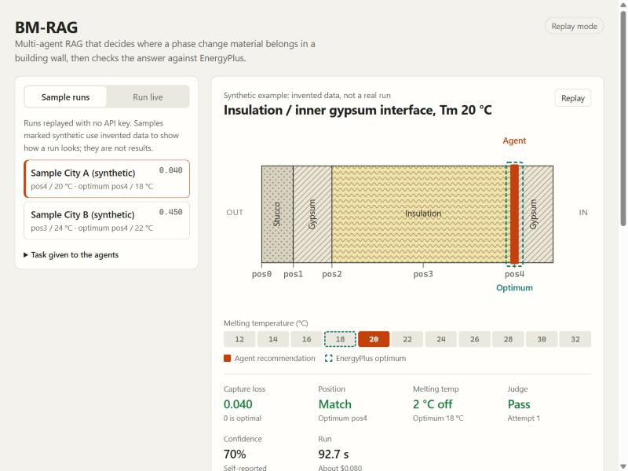
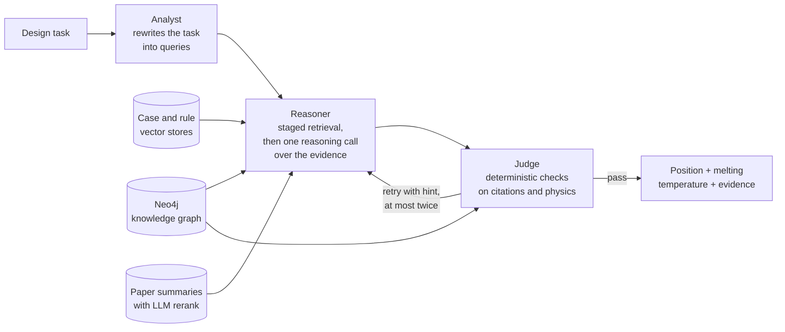

# BM-RAG

A multi-agent hybrid RAG system for building materials. Given a climate, a wall and a phase change material (PCM), it recommends where to place the PCM in the wall and which melting temperature to use, citing the research behind the answer. Recommendations are evaluated against an EnergyPlus parameter sweep.



## Try the demo

The demo replays sample runs. It needs only Python (tested on 3.12 and 3.14): no packages, API key or database.

```bash
python web/server.py
```

Then open <http://127.0.0.1:8765>. Each run shows the pipeline trace, the wall section, the reasoning with clickable citations, the Judge's checks and the token cost.

Two kinds of sample are included. Recorded runs are single real runs, shown to explain how the system works; the paper text in their evidence is removed. Synthetic samples use invented tasks, evidence, reasoning and energy figures. Neither kind is an evaluation.

## How it works



The knowledge graph holds 170 cases and 58 rules extracted from 22 papers. The Reasoner runs every retrieval stage in a fixed order, cheapest first, and then makes one LLM call over the collected evidence; paper search only runs when the graph has too few cases with a known optimum. See [docs/architecture.md](docs/architecture.md) for every stage, trigger and setting.

## Repository layout

| Path | Contents |
|---|---|
| `src/bmrag/agents/` | Analyst, Reasoner and Judge |
| `src/bmrag/retrieval/` | Knowledge-graph index, Neo4j queries, paper search |
| `src/bmrag/prompts/` | Every prompt, as a text file |
| `src/bmrag/build/` | Build pipeline from PDFs to the paper index, the graph and its index ([stages and settings](docs/build_pipeline.md)) |
| `src/bmrag/evaluation/` | Scoring against the EnergyPlus ground truth |
| `src/bmrag/profiles.py` | Named pipeline configurations; `paper_v1` reproduces the paper |
| `src/bmrag/llm.py` | Model providers |
| `experiments/` | Ablation experiments, problem sets and retrieval evaluation |
| `simulation/energyplus/` | EnergyPlus parameter sweep that produces the ground truth |
| `web/` | Web demo: standard-library server, static page and samples |
| `tools/` | Run tracing and Neo4j input rebuild |
| `tests/` | Regression tests against the behaviour behind the paper |
| `docs/` | Architecture and build pipeline |

Papers, chunks, vector stores, experiment results and secrets are not in Git. They live in the git-ignored `data/` and `runs/` folders. The code builds everything from your own PDFs; no paper content is included.

## Running the real pipeline

This requires the knowledge-graph data, which is not public (you can build it from your own PDFs, see [docs/build_pipeline.md](docs/build_pipeline.md)), and an API key. One run costs about US$0.15-0.40 with the default models.

1. **Environment.** Requires [uv](https://docs.astral.sh/uv/) and Python 3.12.

   ```bash
   uv venv .venv --python 3.12
   ```

   ```bash
   uv pip install --python .venv -r requirements-agents.lock.txt
   ```

   ```bash
   uv pip install --python .venv --no-deps -e .
   ```

2. **Configuration.** Copy [.env.example](.env.example) to `.env` in the repository root and fill in your keys and the Neo4j password.

3. **Data.** Put the stores under `data/`, or point `BMRAG_DATA_DIR` at them. [docs/build_pipeline.md](docs/build_pipeline.md) shows how to build them from PDFs:

   ```text
   data/kg_index/       chroma_db/, case_store.json, rule_store.json
   data/paper_index/    chroma_db/, docstore/, summaries/, manifest.json
   data/kg_canonical/   standardized records for the Neo4j import
   ```

4. **Neo4j.** Start a local Neo4j instance (tested on 2026.10) with an empty `neo4j` database, then import the graph. If `data/kg_canonical/` is missing but the stores exist, write it from the stores first:

   ```bash
   .venv/Scripts/python.exe -X utf8 tools/rebuild_neo4j_input.py
   ```

   ```bash
   .venv/Scripts/python.exe -X utf8 -m bmrag.build neo4j --neo4j-database neo4j
   ```

   The agents read the database named by `NEO4J_DATABASE` (default `neo4j`), so a graph imported elsewhere can be used without touching `neo4j`.

5. **Run.** Start the demo in live mode and use the **Run live** tab, or run one task from the command line:

   ```bash
   .venv/Scripts/python.exe -X utf8 web/server.py --live
   ```

   ```bash
   .venv/Scripts/python.exe -X utf8 -m bmrag.pipeline --task task.json --out result.json
   ```

   A task file holds the fields of `AnalystInput` (`src/bmrag/schemas.py`); the 18 evaluation tasks are in `experiments/problem_sets/problem_set_18city.json`, under `analyst_input`. Live mode binds to `127.0.0.1` by default and allows one run at a time. The command line prints the estimated cost; `--out` also saves token usage per caller and model, and the event trace.

To record metrics from the command line, use `tools/trace_pipeline.py --mode scan` or `--mode full`.

## Model providers

The provider comes from the model name. Set the matching key in `.env`, and choose models with `ANALYST_MODEL`, `REASONER_MODEL` and `PAPER_RERANK_MODEL`.

| Model name | Provider | Key | Extra package |
|---|---|---|---|
| `gpt-*`, `o1*`, `o3*`, `o4*` | OpenAI | `OPENAI_API_KEY` | none |
| `deepseek-*` | DeepSeek | `DEEPSEEK_API_KEY` | none |
| `openai-compatible:<model>` | Any OpenAI-style endpoint | `OPENAI_COMPATIBLE_API_KEY`, `OPENAI_COMPATIBLE_BASE_URL` | none |
| `claude-*` | Anthropic | `ANTHROPIC_API_KEY` | `langchain-anthropic` |
| `gemini-*` | Google | `GEMINI_API_KEY` | `langchain-google-genai` |
| `meta-llama/*` | Hugging Face | `HUGGINGFACEHUB_API_TOKEN` | `langchain-huggingface` |

Routing is covered by tests that use stand-in clients; only OpenAI has been run against a real API. Vector search still needs `OPENAI_API_KEY`, because a query must be embedded by the model that built the store. Changing any model leaves the `paper_v1` configuration, so results are no longer comparable with the paper.

## Tests

No test calls an API or needs a database:

```bash
python -X utf8 -m unittest discover -s tests -t .
```

The regression tests compare every prompt, LLM setting, Cypher query, retrieval query and result with a baseline recorded from the code behind the paper.

## Project status

| Part | Status |
|---|---|
| Agent pipeline with all retrieval stages | Verified on Python 3.12 with Neo4j 2026.10 before the package refactor. After it (2026-11-10): from a fresh copy of this repository installed as above, data built from one PDF, the graph imported, and one task run from the command line; behaviour is checked offline by the regression tests |
| Web demo, replay | Verified, also from a fresh copy with Python alone (no packages) |
| Web demo, live | Verified before the package refactor |
| Scoring against the embedded ground truth | Verified on 750 recorded results |
| Build pipeline (paper index, graph, KG index) | `python -m bmrag.build all` run end to end on one paper with real APIs, including the Neo4j import (2026-11-10, see the build run record). A regression test shows the same outputs and LLM requests as the scripts behind the paper, on a synthetic and a real paper. Not re-run on the full paper set |
| EnergyPlus sweep | Code included; not re-run in this environment. Recorded energy covers part of the grid, so some new recommendations show capture loss as n/a |

Results vary between runs of the same task, so compare changes over repeated runs.

## Build run record

Configurations used when the build pipelines were run.

### 2026-11-10: fresh copy, following this README

A fresh copy of the repository, installed with the commands above and the build lock file, then the build and one agent task, with no changes to the copy except the fix below.

| Setting | Value |
|---|---|
| Install | `requirements-agents.lock.txt`, then `requirements-build.lock.txt`, each followed by `--no-deps -e .`; the offline tests pass (76, 6 skipped for packages, data and slow tests not in this install); the replay demo runs with Python alone |
| Build | `python -m bmrag.build all --neo4j-database <new empty database>` on the same PDF; default profile `paper_v1_unique_ids`; 7 cases and 4 rules; about 11.5 minutes; about US$0.15 |
| Import | Stopped first on two false positives: paper text containing the word "remove" was read as a destructive Cypher keyword. The check now ignores quoted strings (the original step 7 had the same check but imported anyway). Then 159 nodes, with one rule-integrity warning |
| Agent run | Chicago task from the problem set, `NEO4J_DATABASE` set to the new database: pos4, Tm 18 °C, passed on the first attempt (the optimum is pos4, 16 °C); all 5 case and rule citations verified by the judge; 132 s; US$0.147 as reported by the command line. One paper, so not comparable with the paper's results |

### 2026-11-10: one paper, end to end with `python -m bmrag.build`

| Setting | Value |
|---|---|
| Command | `python -m bmrag.build all --data <separate folder> --neo4j-database <new empty database>`, profile `paper_v1` (then the default; now pass `--profile paper_v1`) |
| Scope | The same PDF as on 2026-11-07 (13 pages) |
| Environment | As on 2026-11-07: Python 3.12.5 on Windows, CPU only, [requirements-build.lock.txt](requirements-build.lock.txt); Poppler 25.07.0 and Tesseract 5.4.0 on `PATH`; Neo4j 2026.10.1 |
| Models | Summaries and extraction `gpt-5-mini` (one model); embeddings `text-embedding-3-small`; standardize without the LLM pass |
| Time | About 13 minutes: chunking 99 s, summaries 537 s, extraction 151 s, the rest a few seconds |
| Result | 24 embedded paper elements; 6 cases and 4 rules; 148 nodes and 244 relationships. The first import stopped on one rule-integrity finding (a `FAVORS` rule without a wall position); the stage was changed to warn on such findings, as the original step 7 did, and the import was repeated |
| Cost | About US$0.16 at list prices: summaries US$0.130, extraction US$0.031 (embeddings not counted) |
| Agent run | One task (Chicago, `paper_v1`) on this data: pos3, Tm 24 °C after 3 attempts, 319 s. With one paper the knowledge graph is far smaller than the paper's, so the answer is not comparable with the paper's results. The model numbered the ids `C1` and `R1`, so the judge could check none of the case and rule citations; builds now default to `paper_v1_unique_ids` |

### 2026-11-07: one paper, both stores and the graph

Run with the step scripts that preceded `python -m bmrag.build`; the stage names below map one to one.

| Setting | Value |
|---|---|
| Scope | 1 PDF (13 pages), written to a separate `BMRAG_DATA_DIR` |
| Environment | Python 3.12.5 on Windows, CPU only; packages in [requirements-build.lock.txt](requirements-build.lock.txt) (`unstructured` 0.20.8, `unstructured-inference` 1.6.14, `torch` 2.14.1 CPU, `pymupdf` 2.0, `pdfplumber` 0.11.10); Poppler 25.07.0 and Tesseract 5.4.0 on `PATH` |
| Paper index | Steps 1-4 with default settings, 1 chunking worker; `hi_res` partitioning succeeded; summaries by `gpt-5-mini-2025-08-07`; embeddings by `text-embedding-3-small` |
| Graph step 0 | Defaults: candidates `gpt-4o` and `gpt-5-mini`, judge `gpt-5.2`, temperature 0.1, `MAX_TOKENS` 24000, every page sent as an image at 1.5x scale. The `gpt-4o` request was rejected because 24000 exceeds its output limit, so only `gpt-5-mini` produced a record and the judge was not called. The comparison mode was removed afterwards; extraction now uses `gpt-5-mini` alone |
| Graph steps 2-6 | `step2_extract_entities_relations --input data/kg_cases/ALL_papers.json`, `step5_generate_cypher --input data/kg_entities/ALL_papers_structured.json`, `step6_standardize` without `--use-llm`; the quality check ran on a folder-mode step 2 output, because it skips `ALL_*` files |
| Index and import | `build_kg_index`; `step7_import_neo4j --database <new database>` after a dry run, Neo4j 2026.10.1 |
| Result | 24 embedded paper elements; 5 cases and 5 rules; 155 nodes and 228 relationships |
| Cost | About US$0.17 at list prices, mostly the paper summaries |

## License

The code is released under the [MIT License](LICENSE). The license covers the code only, not papers or data derived from them.
