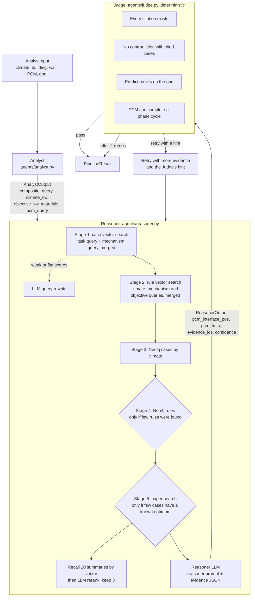

# BM-RAG architecture

How the pipeline is put together: the agents, the retrieval stages and their triggers, the data each step needs, and the settings. Everything below describes the `paper_v1` profile, which reproduces the configuration used in the paper.

## Entry points

| Entry point | Purpose |
|---|---|
| `src/bmrag/pipeline.py`, `run(task, profile=None)` | Runs one design task |
| `src/bmrag/profiles.py` | Named configurations; every setting that can change a result is here |
| `experiments/ablation/run_ablation.py` | Ablation experiments; profiles turn stages or agents off |
| `tools/trace_pipeline.py` | Records the agent timeline, every retrieval, every LLM call (model, tokens, time, cost) and which stages ran |

## Flow

## Agents

### Analyst (`agents/analyst.py`)

Rewrites the free-text task into what retrieval needs: `climate_query`, `construction_query`, `pcm_query`, `composite_query`, `materials`, `objective_kw`, `climate_kw` and parsed PCM properties. Model `profile.analyst_model` (default `gpt-5-mini`), temperature 0.

### Reasoner (`agents/reasoner.py`)

`collect_evidence` runs the retrieval stages, cheapest first:

| Stage | Function | Runs when | First attempt | Source |
|---|---|---|---|---|
| 1 Cases | `retrieve_cases_with_fallback` + `retrieve_cases` on a mechanism query | Always | top_k 5 + 2 | Chroma `pcm_kg_cases_v1` |
| 1' Query rewrite | `_rewrite_query` | Top-1 score < 0.45 or top-5 spread < 0.02 | | Analyst model |
| 2 Rules | `retrieve_rules`, 3 queries | Always | top_k 3/3/2 | Chroma `pcm_kg_rules_v1` |
| 3 Neo4j climate | `run_template("cases_by_climate")` | Always | limit 8 | Neo4j |
| 4 Neo4j rules | `run_template("rules_by_climate_objective")` | Fewer than 4 rules | limit 8 | Neo4j |
| 5 Papers | `retrieve_paper_chunks` | Fewer than 6 cases with a known optimum | recall 20, keep 3 | Chroma `multi_modal_rag` + rerank model |

The evidence is packed into one JSON list (`_pack_case`, `_pack_rule`, `_pack_graph_row`, `_pack_paper`) and inserted into `prompts/reasoner.txt`. The Reasoner model (`profile.reasoner_model`, default `gpt-5`, temperature 0) returns JSON: position, melting temperature, reasoning chain, evidence ids, confidence and alternatives.

Prediction grid, the same as `simulation/energyplus/config.yaml`:

| Position | Location |
|---|---|
| pos0 | Outside surface, before the stucco |
| pos1 | Stucco / gypsum interface |
| pos2 | Gypsum / insulation interface |
| pos3 | Middle of the insulation |
| pos4 | Insulation / inner gypsum interface |

Melting temperature: one of 12, 14, ..., 32 °C.

### Judge (`agents/judge.py`)

All checks are deterministic.

| Check | Outcome | Details |
|---|---|---|
| Citation exists | fatal | Cases are looked up in Neo4j, rules in `rule_store.json` |
| Position contradiction | fatal | The prediction and a cited case favour opposite ends of the wall |
| Grid membership | fatal | Position and melting temperature must be on the grid |
| Phase-cycling feasibility | soft | Uses the indoor setpoints in the task's `building_type` |

Any fatal or soft issue asks the Reasoner to retry; otherwise the verdict is `pass`.

### Retries (`pipeline.py`)

Attempt 1 uses `top_k_cases=5, top_k_rules=3`. Attempts 2 and 3 use 6 and 4, add the Judge's hint and the previous prediction to the prompt, and run all retrieval stages again. After the last retry the pipeline returns the last attempt.

## Data

| Data | Location (`data/`, movable with `BMRAG_DATA_DIR`) | Used by |
|---|---|---|
| `.env` | Repository root | API keys, Neo4j connection |
| Case and rule index | `kg_index/`: `chroma_db`, `case_store.json`, `rule_store.json` | Stages 1 and 2; Judge rule check |
| Neo4j | Local instance, imported from `kg_canonical/` | Stages 3 and 4; Judge case check |
| Paper index | `paper_index/` | Stage 5 |
| EnergyPlus results | `simulation/energyplus/results/summary.csv` | Scoring |

Queries must be embedded with `text-embedding-3-small`, the model that built the stores. See [build_pipeline.md](build_pipeline.md).

## Settings

| Setting | Where | `paper_v1` |
|---|---|---|
| Models | `profiles.py`; `ANALYST_MODEL`, `REASONER_MODEL`, `PAPER_RERANK_MODEL` override them | gpt-5-mini, gpt-5, gpt-5.2 |
| `sufficient_cases`, `sufficient_rules` | `profiles.py` | 6, 4 |
| Rewrite thresholds | `profiles.py` | top-1 0.45, spread 0.02 |
| Paper candidates, results kept | `retrieval/papers.py`, `profiles.py` | 20, 3 |
| `max_retries` | `profiles.py` | 2 (at most 3 attempts) |
