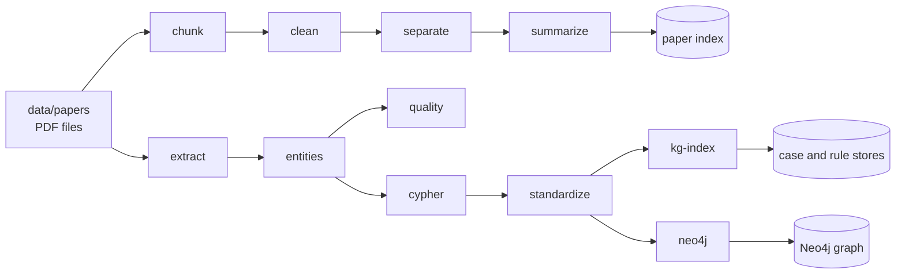

# Build pipeline

The build pipeline turns paper PDFs into the three data sources the agents read. The code lives in `src/bmrag/build/`.

- **Paper index**: summaries of every text block, table and figure, searched by the Reasoner's paper stage.
- **Knowledge graph**: cases and rules imported into Neo4j.
- **Knowledge-graph index**: the same cases and rules in two vector stores.

The settings below are the `paper_v1` profile, which has the settings behind the data used in the paper. Without `--profile`, the build uses `paper_v1_unique_ids`: the same settings, with case and rule ids the judge can check (see [Extraction](#extraction)). Use `--profile paper_v1` to compare with the paper. The profiles are defined in `src/bmrag/build/profiles.py`. The prompts are in `src/bmrag/prompts/`.



## Requirements

| Part | Needs |
|---|---|
| Graph stages | `pymupdf`, `pdfplumber` (`pip install .[knowledge-graph]`), `OPENAI_API_KEY` |
| Paper index | `unstructured[pdf]` and `torch` (`pip install .[indexing]`), plus [Poppler](https://github.com/oschwartz10612/poppler-windows) and [Tesseract](https://github.com/UB-Mannheim/tesseract/wiki) on `PATH`. Without them, chunking falls back to the `fast` strategy, which extracts no tables or images. The first run downloads layout and table models from Hugging Face. |
| Neo4j import | A running Neo4j 5 or later. Set `NEO4J_PASSWORD` in `.env`, and optionally `NEO4J_URI` and `NEO4J_USER`. |
| Verified versions | [requirements-build.lock.txt](../requirements-build.lock.txt) (Python 3.12, Windows, CPU only) |

To install the verified versions into the `.venv` from the README (it replaces packages there with the versions in the lock file):

```bash
uv pip install --python .venv -r requirements-build.lock.txt
```

```bash
uv pip install --python .venv --no-deps -e .
```

Only process PDFs that you have the right to text-mine. Many subscriptions and library terms forbid text and data mining or bulk processing.

## Running it

From the repository root:

```bash
python -m bmrag.build all
```

```bash
python -m bmrag.build paper-index --workers 4
```

```bash
python -m bmrag.build graph --paper "Some paper.pdf"
```

```bash
python -m bmrag.build neo4j --neo4j-database pcmtrial
```

A target is `all`, `paper-index`, `graph`, or one or more stage names. Stages always run in pipeline order. `python -m bmrag.build --list` lists the stages.

| Option | Effect |
|---|---|
| `--data DIR` | Data folder. Default: `BMRAG_DATA_DIR`, or `data/`. PDFs are read from `DIR/papers/`. |
| `--paper FILE`, `--limit N` | Process only these PDFs, or only the first N by name. |
| `--force` | Redo work whose output exists. Without it, cached chunks, cleaned chunks, summaries, extracted papers and existing vectors are reused, so an interrupted run resumes. |
| `--strict` | Stop on validation problems. Without it, they are recorded as warnings. |
| `--workers N` | Processes for PDF chunking. |
| `--profile NAME`, `--set SECTION.FIELD=VALUE` | Choose the profile (default `paper_v1_unique_ids`; `paper_v1` for the paper's settings) or change one setting, e.g. `--set standardize.use_llm=true`. A changed profile is recorded as `<name>+overrides`. |
| `--neo4j-database NAME` | Import target. Without it, the `neo4j` stage only validates. |
| `--allow-non-empty`, `--clear-database` | Allow importing into a database that already has nodes: merge into it, or delete everything first. |

Stages that call a paid API: `summarize` (one call per element), `extract` (one call per paper, plus a JSON repair when needed), `standardize` with `use_llm`, and the embeddings in `summarize` and `kg-index`. A 13-page paper cost about US$0.17 at list prices for both builds together, mostly for the summaries.

## Run records

Every run writes `DATA/build_runs/<UTC time>.json`. It records:

- the command and the full profile, including any overrides
- the git commit and whether the working tree had uncommitted changes
- the versions of Python, the packages, Poppler and Tesseract
- each input PDF with its SHA-256
- each stage's duration, result and counts
- warnings
- the token usage per stage and model, with a list-price estimate
- the SHA-256 of the main output files

API keys are never written.

## Paper index

This is a multi-representation index. Each element gets an LLM summary, and the summary is what gets embedded. The raw element is kept in a docstore under the same `doc_id`. A search matches the summaries and returns the raw elements.

| Stage | Output | What it does |
|---|---|---|
| `chunk` | `paper_chunks/<md5 of file name>.pkl` | Partition with `unstructured.partition_pdf`, then chunk `by_title` |
| `clean` | `paper_chunks_cleaned/` | Drop references and back matter |
| `separate` | `paper_index/{texts,tables,images}/`, `manifest.json` | Split chunks into elements and filter images |
| `summarize` | `paper_index/summaries/`, `chroma_db/`, `docstore/` | Summarize each element and embed the summaries |

| Setting | Value |
|---|---|
| Partition strategies, tried in order | `hi_res` (table structure, image blocks in the payload), then `fast`, then `ocr_only` |
| Chunking | `by_title`; `max_characters` 10000, `combine_text_under_n_chars` 2000, `new_after_n_chars` 6000 |
| Sections always dropped | acknowledgment(s), bibliography, credit authorship contribution statement, author contribution, declaration of competing interest, conflict of interest, data availability, appendix, supplementary material |
| Sections dropped near the end only | reference, references, within the last 4 chunks |
| Element id | `{chunk file stem}__{text\|table\|image}__{0000}` |
| Images filtered when | page area share below 0.01, width or height below 50, aspect ratio above 10 or below 0.1, or no coordinates. Filtered images stay in the manifest with the reason. |
| Summary model | `gpt-5-mini`, provider default temperature; prompts `paper_summary_text.txt` and `paper_summary_image.txt` |
| Summary batching | text and tables 10 per batch, 50 concurrent calls, no retries; images one at a time, default retries |
| Embeddings | `text-embedding-3-small`, 500 per batch; Chroma collection `multi_modal_rag`, id key `doc_id` |

Retrieval (`src/bmrag/retrieval/papers.py`) takes 20 candidates from vector search, reranks them with `gpt-5.2` in batches of 10 using the summary text, and keeps 3 (5 in the Naive RAG baseline). The existing index holds 22 papers: 864 elements (255 text, 105 tables, 504 images), of which 153 images are filtered, leaving 711 embedded summaries.

## Knowledge graph

| Stage | Reads | Writes | What it does |
|---|---|---|---|
| `extract` | `papers/*.pdf` | `kg_cases/<paper>.json`, `ALL_papers.json`, `ALL_cases.json` | One multimodal LLM call per paper returns its cases and rules |
| `entities` | `kg_cases/ALL_papers.json` | `kg_entities/ALL_papers_structured.json` | Normalize into entities, relations, evidence snippets and mechanism chains |
| `quality` | the entity records | `kg_entities/step2_quality_report.json` | Check required fields, labels and relations |
| `cypher` | the entity records | `kg_cypher/ALL_papers_structured_kg.json` | Write Cypher MERGE statements for each record |
| `standardize` | the Cypher records | `kg_canonical/ALL_papers_structured_standardized.{json,cypher}`, `canonical_map.json`, reports | Align entity names and enforce the PCM ontology |
| `kg-index` | the standardized records | `kg_index/case_store.json`, `rule_store.json`, `chroma_db/` | Embed one document per case and per rule |
| `neo4j` | the standardized Cypher | `kg_canonical/step7_dry_run_report.json`, Neo4j | Validate, then import with `--neo4j-database` |

### Extraction

The model sees:

- the full text from PyMuPDF, with page markers
- every table pdfplumber finds, as Markdown
- each page whose text mentions a figure, wall, layer, section or similar term, as a PNG at 1.5x scale

A text over 120,000 characters loses its references section. The paper type (original, review or meta-analysis) is guessed from the title and abstract. It is passed to the model only as a hint.

| Setting | Value |
|---|---|
| Model | `gpt-5-mini`, one model per paper. A `claude-*` model name sends the request to Anthropic instead. |
| Prompt | `kg_case_extraction_research.txt`, wrapped in a JSON contract; see `graph/extraction_prompt.py` |
| Output limit | `max_completion_tokens` 24000; gpt-5 models take no temperature, other models get 0.1 |
| Invalid JSON | the same model repairs the syntax only; if that fails, the request is repeated with the parse error, up to 3 attempts, waiting 5 s times the attempt number |

The case and rule ids come from the model. The stores and the graph key records by these ids alone. If two papers return the same id, only one of the records is kept, so the `entities` stage reports duplicates. With `--strict`, a duplicate stops the build.

The judge has a second problem with these ids. It tells cases from rules by how a cited id starts (`case...`, or `rule...` / `Rule<digit>`), and does not check an id that matches neither. In `paper_v1`, 23 of the 170 case ids (such as `R1` or `baseline_no_PCM`) and 7 of the 58 rule ids (`R1`-`R7`) match neither, so citations of them are never checked.

The default profile, `paper_v1_unique_ids`, fixes both. In a one-paper run with `paper_v1` (2026-11-10) the model numbered the ids `C1`-`C6` and `R1`-`R4`, and the judge checked none of the case and rule citations. The profile does this:

- It puts `case_` or `rule_` in front of an id that does not already start that way, so `R1` becomes `case_R1` or `rule_R1`.
- It appends a key of the paper's PDF, so `rule_R1` becomes `rule_R1@3f2a9c1e`. The key is the first 8 hex digits of the PDF's SHA-256. Under this profile the `extract` stage records the hash as `source_pdf` for each paper in `ALL_papers.json`, also for reused records, so switching profiles needs no new API call. The key does not depend on anything the model writes, so it stays the same when a PDF is renamed or extracted again. Two copies of the same PDF get the same key, and the `entities` stage then reports their ids as duplicates.
- Rules' `evidence_case_ids` are renamed in the same way. The id before renaming is kept as `local_case_id` or `local_rule_id`.

Everything else is as in `paper_v1`, but the graph and stores differ from the paper's.

### Graph and its index

| Setting | Value |
|---|---|
| Node keys | Paper by `paper_id`, Case by `case_id`, KGRule by `rule_id`, every other node by `name`; one uniqueness constraint per label (22) |
| Ontology | labels and relationship types in `graph/ontology.py`; older names are mapped to current ones |
| Name alignment | known aliases, singular forms and leading numbers are grouped, and the most frequent form wins. With `standardize.use_llm`, `gpt-4o-mini` then reviews up to 600 frequent names, 80 per call. |
| Validation | balanced delimiters, no destructive keywords, only ontology labels and types, every rule backed by an evidence case. An error in the Cypher itself always stops the `neo4j` stage. Rule-integrity findings, such as a `FAVORS` rule whose target the model did not make a wall position, are about the extracted content: they are recorded as warnings and imported, as the original step 7 did, and stop the stage only with `--strict`. The graph used in the paper has 7 of them. |
| Import safety | an explicit `--neo4j-database`; an import into a database that already has nodes is refused unless `--allow-non-empty` or `--clear-database` is given |
| Embedded case text | case and paper id, source file, climate fields, season, orientation, wall assembly, PCM position, optimal position, performance metrics, summary, location-related entities |
| Embedded rule text | rule and paper id, source file, summary, relation, subject, object, condition, evidence sentence, evidence case ids, entities, nodes, relations |
| Collections | `pcm_kg_cases_v1`, `pcm_kg_rules_v1`; score returned by retrieval: `1 / (1 + distance)` |

The existing stores hold 170 cases and 58 rules from 22 papers. The original output of the standardize stage was not kept. Its records survive in the stores, so `tools/rebuild_neo4j_input.py` can write the input of the `neo4j` stage again. A graph rebuilt this way may differ slightly from the original graph.

## Tests

| Test | What it checks |
|---|---|
| `tests/test_build_units.py` | Each stage's logic on a synthetic paper, with stand-in LLM and Neo4j clients; runs in seconds |
| `tests/test_build_pipeline.py` | The whole pipeline against a baseline recorded from the code before the refactor. It compares every output file, the Chroma contents and the digest of every LLM request. Set `BMRAG_BUILD_TESTS=1` to run it; it takes several minutes per paper. |

The synthetic paper (`tests/build_fixtures.py`) is invented, so the tests can run anywhere. The second case of the pipeline test uses a real paper and runs only where the local data exists. The baselines store digests only, never paper text.
